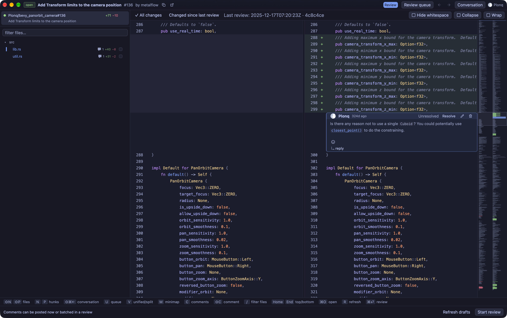

# Gander

A fast, native macOS app for reviewing GitHub pull requests.

Gander is personal software with a singular focus: make it easier to understand PRs and give good human reviews. It starts with your pending review requests and puts the code front and centre. It is not a general-purpose GitHub client or an IDE.

The priorities are two features GitHub itself lacks: **fast diff navigation** and **full-file context** (by default). Keep the information dense, leave out what doesn't help the review, and stay out of the way.



## Features

- **Your review queue.** See pending requests, filter by organisation or repository, and revisit recent reviews.
- **Full files, not just hunks.** Unified or split diffs with syntax highlighting, word-level changes, image comparisons, and surrounding code for context.
- **Fast navigation.** Keyboard shortcuts, a fuzzy file filter, diff-wide search, and a minimap. Pick up where you left off with remembered review positions.
- **Focus on what's new.** See changes since your last review, hide whitespace changes, fold unchanged code, and mark files as viewed on GitHub.
- **The whole conversation.** Read the PR description, discussion, and review threads, including images and videos, alongside the code.
- **Review without switching tools.** Write inline and multi-line comments, reply to and resolve threads, keep drafts, and submit approvals or change requests.
- **Local diffs too.** Open a local repository to inspect its changes without a GitHub PR.

## Quick Start

Requires **Apple Silicon** and **macOS 15 or later**. GitHub reviews use your [GitHub CLI](https://cli.github.com/) login (`gh`); local diffs work without it.

### Install

1. Download [Gander.dmg](https://github.com/Plonq/pr-reviewer/releases/download/latest/Gander.dmg) from the [latest build](https://github.com/Plonq/pr-reviewer/releases/tag/latest).
2. Open the disk image and drag **Gander** into **Applications**.
3. Install the GitHub CLI if needed, then sign in:

   ```sh
   brew install gh
   gh auth login
   ```

Builds are **not notarised**. If macOS blocks Gander, attempt to open the installed
app, then choose **System Settings → Privacy & Security → Open Anyway**.
Publishing requires no paid Apple Developer account; see [release workflow](docs/releases.md).

### Review your first PR

1. Open Gander to see your pending review requests.
2. Select a PR to read its conversation. Switch to **Changes** or click a file on the left to review the code.
3. Use **`[` / `]`** to move between files, **`n`** for the next hunk, and **`Shift+N`** for the previous hunk. Select a line or range and press **Shift+C** to comment.
4. Add comments to a pending review, then choose **Finish review** to approve, request changes, or submit a comment-only review.

**⌘O** opens a PR by URL or identifier, or a local repository by path. **`U`** returns to the queue without closing your open reviews.

### Build from source

With [Rust](https://rustup.rs/) and Xcode installed:

```sh
git clone https://github.com/Plonq/pr-reviewer.git
cd pr-reviewer
cargo run --release --locked
```

The repository pins the Rust toolchain and targets Apple Silicon. If the build reports a missing Metal toolchain, run `xcodebuild -downloadComponent MetalToolchain`.

## Tech Stack

Built in [Rust](https://www.rust-lang.org/) with [GPUI](https://www.gpui.rs/) for the native UI.

## Acknowledgements & License

Gander started as a fork of [ellie/lgtm](https://github.com/ellie/lgtm) and has since diverged significantly. Thanks to lgtm for the foundation!

Licensed under [MIT](LICENSE), including the original lgtm copyright notice.
